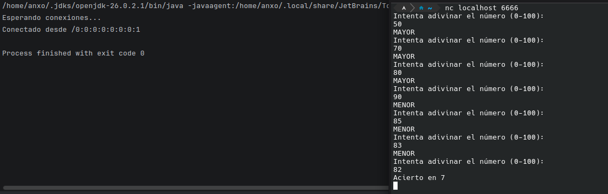

# Tarea 28 - Adivina el número

## Asignatura

- PSP

## Alumno

- Anxo Vázquez Lorenzo

## Servidor

El servidor espera a recibir una conexión de un cliente y después le pide números hasta que lo acierte indicando mayor o menor para ayudarle. 

```java
public static void main(String[] args) {
        int numeroSecreto = (int)(Math.random() * 101); // 0 to 100
        int intentos = 1;
        String entradaUsr = "";
        try {
            ServerSocket servidor = new ServerSocket(6666);
            System.out.println("Esperando conexiones...");
            Socket cliente = servidor.accept();
            System.out.println("Conectado desde " + cliente.getInetAddress());
            BufferedReader entrada = new BufferedReader(new InputStreamReader(cliente.getInputStream()));
            PrintWriter salida = new PrintWriter(cliente.getOutputStream(), true);
            while(true) {
                salida.println("Intenta adivinar el número (0-100):");

                entradaUsr = entrada.readLine();
                if(entradaUsr.toLowerCase().compareTo("adios") == 0){
                    System.out.println("Ok, hasta luego");
                    break;
                }

                try {
                    int numUsr = Integer.parseInt(entradaUsr);
                    if (numUsr < numeroSecreto) {
                        salida.println("MAYOR");
                    } else if (numUsr > numeroSecreto) {
                        salida.println("MENOR");
                    } else {
                        salida.println("Acierto en " + intentos);
                        break;
                    }
                    intentos++;
                }catch (NumberFormatException e){
                    //No lo cuenta como intento
                    salida.println("ERR Comando no válido");
                }
            }
            entrada.close();
            salida.close();
            cliente.close();
            servidor.close();
        } catch (IOException e) {
            System.err.println("Error: " + e.getMessage());
        }catch(NullPointerException e){
            if(entradaUsr == null){
                System.out.println("El usuario se ha desconectado");
            }else{
                System.out.println("Error: " + e.getMessage());
            }
        }
    }
```

## Partida

Lanzo el servidor y me conecto a él con `netcat`:



Si el usuario cierra la partida de forma inesperada se recoge la excepción `NullPointerException`:

[!excep](./imgs/excep.png)

## Bibliografía y Uso de IA

- Oracle Java - PrintWriter

  https://docs.oracle.com/javase/8/docs/api/java/io/PrintWriter.html

> No he necesitado IA para esta tarea

